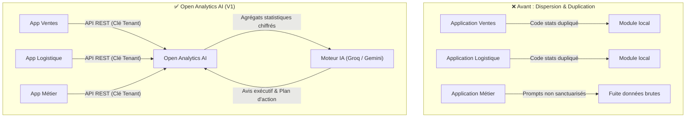
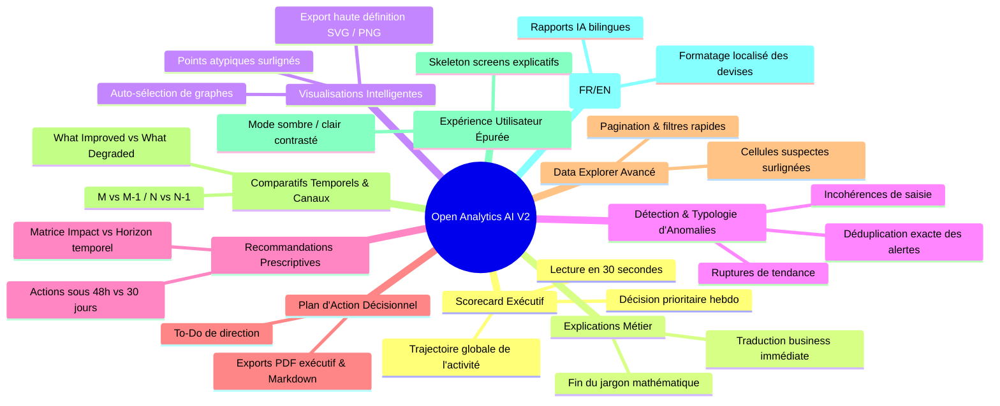

# 🚀 OPEN ANALYTICS AI : PRÉSENTATION DU PROJET & TRAJECTOIRE V2
> **Document de Référence & Vision Stratégique**  
> **Statut :** Document Exécutif & Spécification Stratégique  
> **Auteur :** Architecture & Data Intelligence Team  
> **Date :** Novembre 2026  

---

## Executive Summary (En 1 minute)

**Open Analytics AI** est une plateforme centralisée d'intelligence décisionnelle et de Business Intelligence augmentée par l'Intelligence Artificielle. Conçue nativement pour les écosystèmes multi-applications (ex : CRM, ERP, Agriculture, E-commerce, Santé), elle permet de brancher n'importe quel flux de données via une API REST sécurisée et de générer instantanément :
1. **Des analyses statistiques rigoureuses et auditables** (tendances réelles, distributions, corrélations, détection d'anomalies par consensus multi-méthodes).
2. **Des synthèses stratégiques et avis exécutifs rédigés en langage métier clair**, directement actionnables par les dirigeants, sans jargon mathématique abstrait.
3. **Une garantie absolue de confidentialité (Privacy-First)** : aucune donnée brute client n'est transmise aux modèles de langage (LLMs) ; seuls les agrégats statistiques anonymisés nourrissent le moteur de raisonnement.

---

## 1. Genèse & État Actuel (Version 1)

### 1.1 Le Problème Résolu
Avant Open Analytics AI, chaque application métier d'un écosystème devait développer ses propres modules de calcul, réinventer des visualisations, gérer ses propres seuils d'alertes et risquait de faire fuiter des données brutes sensibles en interrogeant des APIs d'IA générative externes.



### 1.2 Les Fondations Solides Déjà Opérationnelles
- **Backend FastAPI asynchrone** avec validation stricte par Pydantic v2.
- **Moteur statistique déterministe** : Détection d'anomalies par triple consensus (IQR, MAD, Isolation Forest), régression linéaire pour les tendances, matrices de corrélation de Pearson et Spearman.
- **Fournisseurs d'IA multi-fournisseurs** : Connecteur Groq (LLaMA 3.3 70B / GPT-OSS 120B), Google Gemini, LLM local (Ollama) et Mock déterministe pour les environnements de test et CI/CD.
- **Dashboard React moderne (Vite / Tailwind / Recharts)** : Restitution visuelle avec cartes décisionnelles, graphiques chronologiques, alertes contextualisées selon le secteur d'activité et mode multi-jeux consolidé.
- **Déploiement flexible** : Docker / Railway ou Hébergement mutualisé cPanel (Reverse Proxy Uvicorn).

---

## 2. La Vision de la Version 2 (V2)

### 2.1 Du Moteur Statistique à la Plateforme d'Intelligence Décisionnelle
Si la V1 a validé la tuyauterie technique, la précision des algorithmes et la sanctuarisation de la donnée, la **Version 2 (V2)** élève la plateforme au rang de **véritable copilote pour directeurs généraux et analystes de gestion**.

La V2 repose sur deux exigences complémentaires :
- **Pour le Dirigeant / Décideur Opérationnel** : Supprimer toute friction cognitive. Chaque écran doit répondre en 30 secondes à la question : *« Où en est mon activité, où sont les urgences réelles et quelle décision dois-je arbitrer cette semaine ? »*
- **Pour le Data Manager / Contrôleur de Gestion** : Offrir une traçabilité totale (« Zéro boîte noire »). Chaque affirmation de l'IA doit pouvoir être vérifiée jusqu'à la ligne ou à la variable source.

---

## 3. Les 10 Piliers Majeurs de la Roadmap V2



### Détail des 10 Fonctionnalités Cibles :

| # | Pilier Fonctionnel | Apport V2 Concret |
|---|---|---|
| **1** | **Scorecard Exécutif (Executive Brief)** | 3 questions clés en tête de rapport : Santé de la période, victoires/replis majeurs, arbitrage prioritaire de la semaine. Fini les scores de confiance arbitraires : place à la mesure de solidité de l'échantillon. |
| **2** | **Traduction Métier des Statistiques** | Élimination totale du jargon technique : *« Asymétrie positive »* devient *« Quelques très fortes commandes tirent la moyenne vers le haut »* ; *« R² élevé »* devient *« Progression continue et stable »*. |
| **3** | **Visualisation Graphique Intelligente** | Choix automatique du meilleur tracé (séries lissées, treemaps, nuages de corrélation) avec surbrillance directe des points anormaux sur la courbe et infobulles enrichies. |
| **4** | **Qualification Précise des Anomalies** | Typologie claire : pic historique, rupture brutale de tendance, incohérence de données (valeur négative suspecte) avec déduplication stricte des lignes affectées. |
| **5** | **Recommandations Prescriptives** | Hiérarchisation sur matrice 2D : Impact business (Faible/Moyen/Majeur) × Horizon temporel (Immédiat sous 48h, Moyen terme sous 30 jours, Long terme). |
| **6** | **Plan d'Action Décisionnel Opérationnel** | Synthèse des actions correctives sous forme de feuille de route directement exportable en PDF exécutif ou partageable aux équipes de terrain. |
| **7** | **Explorateur de Données Brutes (Data Explorer)** | Table interactive paginée permettant d'auditer les enregistrements, avec mise en évidence ambrée des cellules précises ayant déclenché une vigilance. |
| **8** | **Comparatifs Temporels & Segments** | Analyse automatisée de variation (Mois M vs M-1, Année N vs N-1) et comparaison directe entre deux canaux ou agences (*Ce qui s'est amélioré* vs *Ce qui s'est dégradé*). |
| **9** | **Refonte UX & Sobriété Cognitive** | Formulaires adaptatifs intelligents, masquage des paramètres avancés non pertinents, transitions fluides et temps de chargement illustrés par des étapes compréhensibles. |
| **10** | **Bilinguisme Intégral Natif (FR / EN)** | Support complet de l'anglais et du français, tant sur les composants d'interface que dans la génération narrative par l'IA et le formatage des devises/nombres. |

---

## 4. Architecture Cible & Sanctuarisation Technique

Pour garantir la pérennité du projet, la V2 s'appuie sur une séparation étanche des responsabilités :

```
┌────────────────────────────────────────────────────────────────────────┐
│                        COUCHE PRÉSENTATION (React 19)                  │
│       Executive Brief • Smart Visualizations • Interactive Explorer     │
└───────────────────────────────────┬────────────────────────────────────┘
                                    │ Contrat d'API REST unifié
                                    ▼
┌────────────────────────────────────────────────────────────────────────┐
│                    API GATEWAY & CONTRATS (FastAPI)                    │
│      Validation Pydantic v2 • Rate Limiting • Tenants Applications     │
└──────────────────┬──────────────────────────────────┬──────────────────┘
                   │                                  │
                   ▼                                  ▼
┌──────────────────────────────────────┐  ┌──────────────────────────────┐
│       MOTEUR MATHÉMATIQUE PUR        │  │       MOTEUR D'IA MÉTIER     │
│       (Déterministe & Auditable)     │  │       (Génératif Cadré)      │
│  - Numpy, Pandas, Scipy, Sklearn     │  │  - Sanitarisation anonymisée │
│  - Tendances, Anomalies (Consensus)  │  │  - Contextes sectoriels      │
│  - Corrélations & Régressions        │  │  - Groq / Gemini / Local LLM │
└──────────────────────────────────────┘  └──────────────────────────────┘
```

### Ce qui reste sanctuarisé (Ne change pas) :
- **L'isolation étanche multi-applications** par clé API d'application.
- **La robustesse mathématique éprouvée** (les calculs ne sont jamais délégués à l'IA).
- **Le protocole de confidentialité stricte** : l'IA ne voit jamais de données nominatives ou brutes.

---

## 5. Calendrier de Déploiement V2 (Planning Prévisionnel)

Le déploiement de la V2 s'articule en **4 phases progressives** sans interruption de service :

```
Phase 1 (Semaines 1-2)  : Refonte du Moteur Narratif & Élimination du Jargon
Phase 2 (Semaines 3-4)  : Scorecard Exécutif & Visualisations Intelligentes
Phase 3 (Semaines 5-6)  : Moteur Comparatif Temporel & Data Explorer
Phase 4 (Semaines 7-8)  : Finalisation UX, Bilinguisme & Exports Exécutifs
```

---

## 6. Conclusion & Impact Métier

Avec la V2, **Open Analytics AI** franchit le cap de l'outil technique pour s'imposer comme le **système nerveux décisionnel** des applications connectées. 

En éliminant l'opacité statistique et en apportant des éclairages opérationnels immédiats, la plateforme permet aux organisations de passer de la simple observation des données à l'action stratégique mesurable.
