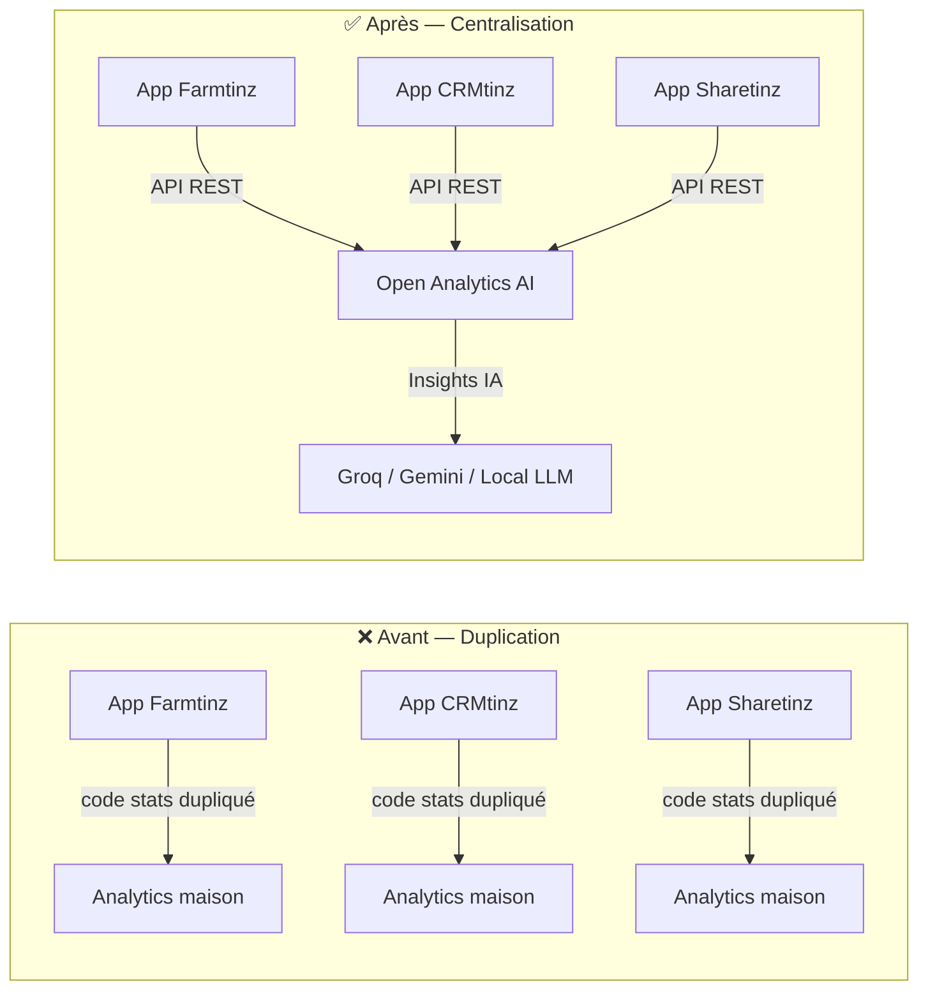
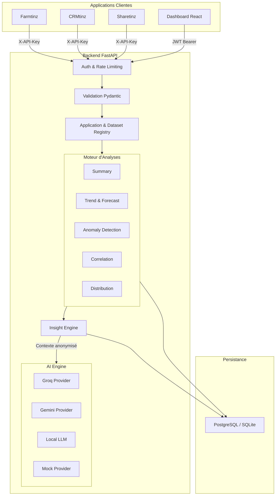
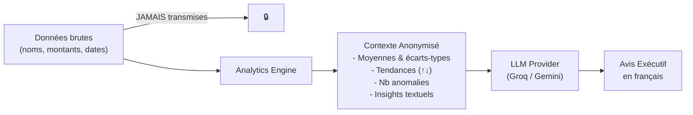
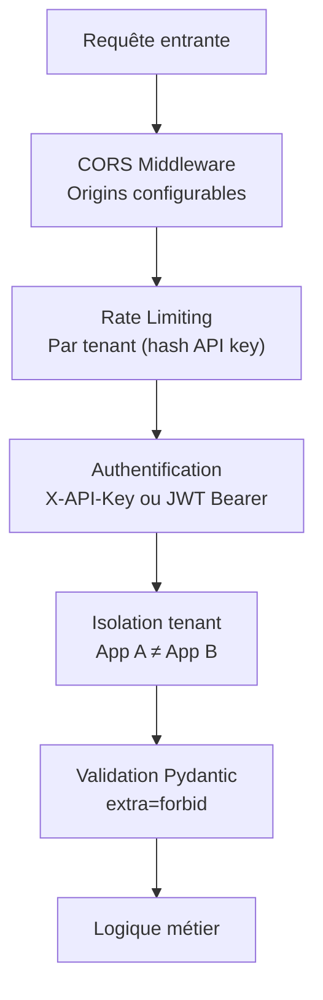
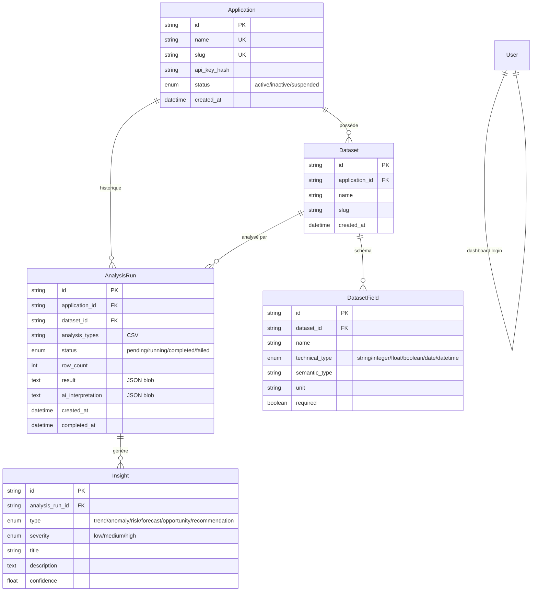
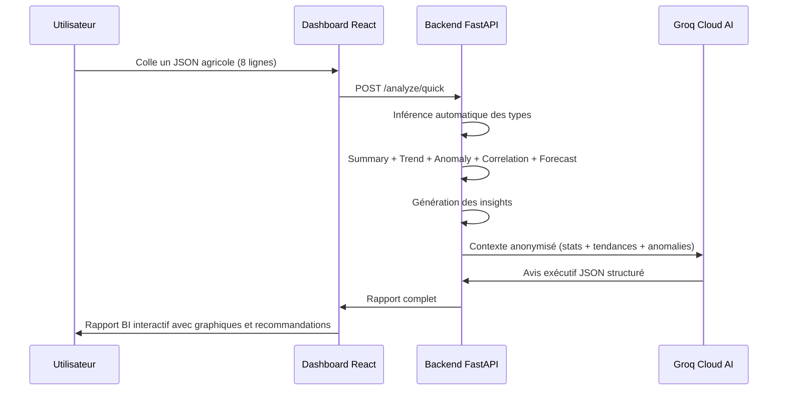

# 🚀 Open Analytics AI
## Plateforme Centralisée d'Intelligence Décisionnelle

> **Moteur d'analyses statistiques robustes et d'interprétations IA stratégiques, accessible via API REST, conçu pour les écosystèmes multi-applications.**

---

## 📋 Sommaire

1. [Vision & Proposition de Valeur](#-vision--proposition-de-valeur)
2. [Problème Résolu](#-le-problème-résolu)
3. [Architecture Technique](#-architecture-technique)
4. [Stack Technologique](#-stack-technologique)
5. [Fonctionnalités Clés](#-fonctionnalités-clés)
6. [Moteur d'Analyse — Le Cœur du Produit](#-moteur-danalyse--le-cœur-du-produit)
7. [Intelligence Artificielle — Avis Exécutifs](#-intelligence-artificielle--avis-exécutifs)
8. [Dashboard React — Interface de Pilotage](#-dashboard-react--interface-de-pilotage)
9. [Sécurité & Isolation](#-sécurité--isolation)
10. [Qualité & Tests](#-qualité--tests)
11. [Déploiement & Infrastructure](#-déploiement--infrastructure)
12. [Schéma de Données](#-schéma-de-données)
13. [Endpoints API — Référence Rapide](#-endpoints-api--référence-rapide)
14. [Roadmap & Évolutions](#-roadmap--évolutions)
15. [Métriques du Projet](#-métriques-du-projet)

---

## 🎯 Vision & Proposition de Valeur

**Open Analytics AI** est un **backend d'analytics réutilisable** qui transforme n'importe quel jeu de données JSON en :

- 📊 **Statistiques descriptives complètes** (moyennes, écarts-types, distributions)
- 📈 **Détection de tendances** avec prévisions chiffrées
- 🚨 **Détection d'anomalies** par consensus multi-méthodes
- 🔗 **Corrélations** inter-variables et inter-datasets
- 🤖 **Interprétations IA** en langage business, adaptées aux décideurs

**Le tout via une simple API REST**, sans ré-implémenter la logique analytique dans chaque application.

> [!IMPORTANT]
> **Valeur fondamentale** : une équipe qui gère plusieurs applications (Farmtinz, CRMtinz, Sharetinz…) branche l'analyse et l'IA avec **une seule API + une clé par app**, au lieu de dupliquer le code partout.

---

## 🔍 Le Problème Résolu



| Problème | Solution Open Analytics AI |
|---|---|
| Chaque app réinvente ses propres stats | Un moteur centralisé, testé, validé |
| Pas d'interprétation métier des données | IA qui génère des avis exécutifs en français |
| Données sensibles exposées aux LLMs | Architecture **Privacy-First** : seules les synthèses chiffrées sont transmises |
| Pas de détection proactive d'anomalies | Consensus croisé IQR + MAD + Isolation Forest |
| Pas de traçabilité des analyses | Historique complet avec statut, résultats, insights persistés |

---

## 🏗 Architecture Technique



### Principes Architecturaux

| Principe | Implémentation |
|---|---|
| **Privacy-First** | L'IA ne reçoit jamais de données brutes — uniquement des synthèses statistiques anonymisées |
| **Pluggable Analytics** | Chaque service hérite de `BaseAnalyticsService` ; ajout d'un type = 1 classe + 1 registration |
| **Application Isolation** | Chaque app = clé API isolée + datasets indépendants + runs d'analyse propres |
| **Repository Pattern** | Tout accès DB passe par des repositories, séparant logique métier et persistance |
| **Fail-safe** | Un service d'analyse qui crash n'empêche pas les autres de s'exécuter |

---

## 🛠 Stack Technologique

### Backend (Python)

| Composant | Technologie | Version |
|---|---|---|
| Framework API | **FastAPI** | 0.141.1 |
| Validation | **Pydantic** + Pydantic-Settings | 2.13.5 |
| ORM | **SQLAlchemy** (Mapped columns) | 2.0.52 |
| Migrations | **Alembic** | 1.19.1 |
| Analyses numériques | **Pandas** + **NumPy** + **SciPy** | 3.0.5 / 2.5.2 / 1.18.1 |
| Machine Learning | **Scikit-learn** (Isolation Forest) | 1.9.0 |
| Rate Limiting | **SlowAPI** + Limits | 0.1.10 |
| Auth | **bcrypt** + **PyJWT** (HS256) | 5.0.0 / 2.15.1 |
| Base de données | **PostgreSQL** (prod) / **SQLite** (dev) | 16-alpine |

### Frontend (JavaScript)

| Composant | Technologie | Version |
|---|---|---|
| Framework | **React** | 19.2.8 |
| Bundler | **Vite** | 8.3.0 |
| Styling | **Tailwind CSS** | 4.3.3 |
| Graphiques | **Recharts** | 3.10.1 |
| Icônes | **Lucide React** | 1.55.0 |
| Linting | **OxLint** | 1.81.0 |

### Infrastructure

| Composant | Technologie |
|---|---|
| Conteneurisation | **Docker** + Docker Compose |
| CI/CD | **GitHub Actions** (ruff lint + pytest) |
| Hébergement backend | **Railway** / Render |
| Hébergement frontend | **Vercel** |

---

## ⚡ Fonctionnalités Clés

### 1. Banc d'Essai Rapide (`POST /analyze/quick`)
- **Zéro configuration** : collez du JSON brut → rapport instantané
- Inférence automatique des types de colonnes
- Idéal pour les démos et les tests rapides
- Rate-limité à 30 req/min

### 2. Analyse Formelle (`POST /analyze`)
- Validation du schéma des données contre le dataset déclaré
- Authentification par clé API (isolée par application)
- Persistance complète : résultats, insights, interprétation IA
- Rate-limité à 20 req/min
- Historique consultable (`GET /analysis`, `GET /analysis/{id}`)

### 3. Analyse Multi-Datasets (`POST /analyze/multi`)
- **Innovation clé** : analyser plusieurs jeux de données en un seul appel
- Corrélations croisées inter-datasets sur une clé d'alignement
- Synthèse consolidée avec verdict (favorable / surveiller / tension)
- Chaque dataset garde son propre run d'analyse (traçabilité)

### 4. Registre d'Applications & Datasets
- CRUD complet des applications clientes
- Déclaration formelle des schémas de données (types, unités, sémantique)
- Génération et rotation de clés API
- Routes admin sécurisées par JWT

---

## 🧮 Moteur d'Analyse — Le Cœur du Produit

Le moteur est composé de **6 services d'analyse indépendants**, chacun spécialisé :

````carousel
### 📊 Summary — Statistiques Descriptives
Calcule pour chaque colonne numérique :
- Moyenne, médiane, écart-type
- Min, max, quartiles (Q1, Q3)
- Count, valeurs manquantes

**Utilité** : vue d'ensemble instantanée de la santé des données.
<!-- slide -->
### 📈 Trend — Détection de Tendances
- Régression linéaire sur les séries temporelles
- Direction : hausse / baisse / stable
- Pourcentage de variation calculé
- Gestion robuste des timezones (UTC, ISO8601, offsets)

**Utilité** : identifier si un indicateur progresse ou régresse.
<!-- slide -->
### 🚨 Anomaly — Détection d'Anomalies
**Consensus multi-méthodes** (3 algorithmes) :
1. **IQR** — Inter-Quartile Range
2. **MAD** — Median Absolute Deviation
3. **Isolation Forest** — Machine Learning (scikit-learn)

Un point est flagué anomalie **seulement si au moins 2/3 méthodes convergent** (confiance ≥ 0.66).

**Utilité** : détecter des valeurs atypiques avec un haut niveau de certitude.
<!-- slide -->
### 🔗 Correlation — Matrice de Corrélations
- Corrélation de Pearson entre toutes les variables numériques
- Identification des corrélations fortes (|r| > 0.5)
- Base pour les recommandations IA

**Utilité** : découvrir les relations cachées entre indicateurs.
<!-- slide -->
### 📉 Distribution — Analyse de Distribution
- Histogrammes et bins automatiques
- Skewness (asymétrie) et kurtosis
- Tests de normalité

**Utilité** : comprendre la répartition des valeurs.
<!-- slide -->
### 🔮 Forecast — Prévisions
- Extrapolation linéaire avec intervalle de confiance
- Intervalle = `± t·σ·√(1 + 1/n + (x₀-x̄)²/Sxx)` — strictement croissant avec l'horizon
- Distribution t de Student (degrés de liberté = n-2)

**Utilité** : projeter les tendances sur les périodes à venir.
````

> [!TIP]
> **Isolation complète des erreurs** : si un service d'analyse crash (ex: pas assez de données pour le forecast), les autres services continuent de s'exécuter normalement. Le run d'analyse n'est jamais perdu.

---

## 🤖 Intelligence Artificielle — Avis Exécutifs

### Architecture Privacy-First



### Providers Supportés

| Provider | Modèle | Cas d'Usage |
|---|---|---|
| **Groq Cloud** | GPT-OSS 120B, Qwen3.8 27B (fallback chaîné) | Production — temps de réponse < 5s |
| **Google Gemini** | Gemini API | Alternative cloud |
| **Local LLM** | Ollama (LLaMA 3) | Déploiement on-premise, confidentialité totale |
| **Mock** | Réponse statique structurée | Développement, tests, démos sans clé API |

### Structure de la Réponse IA

Chaque interprétation produit un JSON structuré :

```json
{
  "provider": "groq (openai/gpt-oss-120b)",
  "confidence": 0.96,
  "summary": "Synthèse exécutive de 3 phrases…",
  "key_findings": ["Constat 1 chiffré…", "Constat 2 chiffré…"],
  "recommendations": ["Recommandation stratégique 1…", "Recommandation 2…"],
  "action_plan": [
    "Priorité Immédiate (< 7 jours) : …",
    "Court Terme (1-4 semaines) : …",
    "Moyen Terme (> 1 mois) : …"
  ],
  "risk_assessment": "Niveau de risque : Modéré — justification…"
}
```

> [!NOTE]
> **Protection anti-injection de prompt** : les données utilisateur sont encadrées par des délimiteurs `<<<DÉBUT DES DONNÉES>>>` / `<<<FIN DES DONNÉES>>>` avec instruction explicite au LLM de les traiter comme données, jamais comme instructions.

---

## 🖥 Dashboard React — Interface de Pilotage

Le dashboard est une **Single Page Application React** (Vite + Tailwind) servant d'interface d'administration et de démonstration.

### Pages Principales

| Page | Rôle |
|---|---|
| **Login** | Authentification JWT (bcrypt + HS256, expiration 12h) |
| **Overview** | KPIs système (statut moteur, BDD, provider IA, apps connectées) + guide d'intégration |
| **Quick Test** | Banc d'essai JSON sans déclaration — exemples agricoles et e-commerce pré-chargés |
| **Analytics** | Pipeline formel avec sélection app + dataset + clé API — mono et multi-datasets |
| **Apps Manager** | CRUD des applications, génération/rotation de clés API, listing des datasets |

### Composant BI Report — Le Rapport Décisionnel

Le composant `BiReport` est le cœur de la restitution visuelle. Il offre **3 vues** :

1. **Synthèse & IA** — Avis exécutif, constats majeurs, recommandations, plan d'action, évaluation des risques
2. **Graphiques** — Visualisations Recharts auto-générées pour chaque colonne numérique
3. **Données** — Table des enregistrements bruts avec pagination

### Design System

- 🌗 **Dark / Light mode** avec transition fluide
- 🎨 Palette **Indigo / Slate / Emerald** professionnelle
- 📱 **Responsive** : layout adaptatif mobile → desktop
- ✨ **Micro-animations** : fade-in des pages, transitions de couleurs
- 🔒 Session JWT avec invalidation automatique sur 401

---

## 🔐 Sécurité & Isolation

### Couches de Sécurité



| Mesure | Détail |
|---|---|
| **API Keys** | SHA-256 hashées avec secret déployement, jamais stockées en clair |
| **Passwords** | bcrypt (salted, adaptive cost) |
| **JWT Dashboard** | HS256, expiration 12h, invalidation automatique |
| **Rate Limiting** | Par route : `/analyze` 20/min, `/applications` 15/min, `/datasets` 30/min — quota par tenant |
| **Isolation tenant** | Routes admin = 404 (pas 403) pour ne pas confirmer l'existence de ressources |
| **CORS** | Configurable par env (`CORS_ORIGINS`), `credentials=False` |
| **Production fail-safe** | Swagger/ReDoc désactivés hors dev, `API_KEY_HASH_SECRET` obligatoire |
| **XSS Dashboard** | `html.escape()` sur toutes les interpolations variables dans le dashboard |
| **Prompt Injection** | Délimiteurs + instruction anti-injection dans les prompts IA |
| **Git Hygiene** | `.gitignore` rigoureux, `.dockerignore`, aucun secret dans le repo |

---

## ✅ Qualité & Tests

### Suite de Tests

| Fichier | Couverture |
|---|---|
| `test_security.py` | 401 sur routes non-auth, isolation cross-tenant, rate-limiting (429), brute-force login |
| `test_analytics.py` | Moteur d'analyse complet, chaque type d'analyse, edge cases |
| `test_multi_analyze.py` | Analyse multi-datasets, corrélations croisées, synthèse consolidée |
| `test_api.py` | Routes API CRUD, health, validation |
| `test_auth.py` | Login JWT, token expiry, protection brute-force |
| `test_ai_provider.py` | Groq/Gemini mocks, prompt injection, format de sortie |
| `test_insights.py` | Génération d'insights depuis résultats d'analyse |
| `test_validator.py` | Validation des schémas de données, types, champs requis |

> **110+ tests** — Suite complète passant en CI.

### CI/CD (GitHub Actions)

```yaml
# Triggers: push + PR → Python 3.12
# 1. ruff check (lint, non-bloquant)
# 2. pytest -q (bloquant)
```

---

## 🚢 Déploiement & Infrastructure

### Docker Compose (Dev/Staging)

```
services:
  postgres:    PostgreSQL 16-alpine (healthcheck pg_isready)
  backend:     FastAPI + Uvicorn (port 8000, volumes pour hot-reload)
```

- Secrets interpolés depuis `.env` (jamais hardcodés)
- Images **non-root** (`USER appuser`, uid 10001)
- Healthchecks intégrés (backend + postgres)

### Production

| Plateforme | Service | Config |
|---|---|---|
| **Railway** | Backend FastAPI | `render.yaml` : auto-scale, Postgres managed, `APP_ENV=production` |
| **Vercel** | Frontend React | `vercel.json` : SPA rewrite |
| **Render** | Alternative backend | `render.yaml` Blueprint : web + database free tier |

---

## 📦 Schéma de Données



---

## 📡 Endpoints API — Référence Rapide

### Système
| Méthode | Route | Auth | Description |
|---|---|---|---|
| `GET` | `/api/v1/health` | — | Statut moteur + BDD + provider IA |

### Analyse
| Méthode | Route | Auth | Description |
|---|---|---|---|
| `POST` | `/api/v1/analyze/quick` | JWT | Test instantané sans déclaration |
| `POST` | `/api/v1/analyze` | API Key | Analyse formelle avec schéma |
| `POST` | `/api/v1/analyze/multi` | API Key | Analyse consolidée multi-datasets |
| `GET` | `/api/v1/analysis` | API Key | Historique des analyses |
| `GET` | `/api/v1/analysis/{id}` | API Key | Détail d'une analyse |

### Applications & Datasets
| Méthode | Route | Auth | Description |
|---|---|---|---|
| `GET` | `/api/v1/applications/admin/all` | JWT | Liste toutes les applications |
| `POST` | `/api/v1/applications` | JWT | Créer une application + clé API |
| `DELETE` | `/api/v1/applications/admin/{id}` | JWT | Supprimer une application |
| `POST` | `/api/v1/applications/admin/{id}/regenerate-key` | JWT | Régénérer la clé API |
| `GET` | `/api/v1/datasets/all` | JWT | Liste tous les datasets |
| `POST` | `/api/v1/datasets` | JWT / API Key | Déclarer un dataset |

### Authentification Dashboard
| Méthode | Route | Auth | Description |
|---|---|---|---|
| `POST` | `/api/v1/auth/login` | — | Login dashboard (JWT) |
| `GET` | `/api/v1/auth/me` | JWT | Utilisateur connecté |

---

## 🗺 Roadmap & Évolutions

### Version Actuelle — V1 ✅

- ✅ Registre d'applications & datasets
- ✅ Validation de schéma de données
- ✅ 6 types d'analyse (summary, trend, anomaly, correlation, distribution, forecast)
- ✅ Analyse multi-datasets consolidée
- ✅ Moteur d'insights automatisé
- ✅ Interprétation IA multi-provider (Groq, Gemini, Local LLM)
- ✅ Dashboard React complet
- ✅ Auth JWT + API Keys + Rate Limiting
- ✅ CI/CD GitHub Actions
- ✅ Docker Compose + configs Railway/Render/Vercel

### V2 — Machine Learning Avancé 🔜

- Segmentation K-means (clustering automatique)
- Alerting proactif & veille continue
- Upload CSV + connecteurs de données
- Natural Language Query (text-to-SQL)

### V3 — LLM Local & Autonomie 🔮

- LLM open-source local (Ollama intégré)
- Analyse en langage naturel
- Export PDF des rapports BI

### V4 — SDK & Intégration Facilitée 🎯

- SDK React / npm package
- Streaming SSE des résultats
- Prévisions avancées (Prophet / ETS)

---

## 📊 Métriques du Projet

| Métrique | Valeur |
|---|---|
| **Lignes de code backend** | ~15 000+ (Python) |
| **Lignes de code frontend** | ~3 500+ (JSX/CSS) |
| **Nombre de tests** | **110+** |
| **Services d'analyse** | **6** (Summary, Trend, Anomaly, Correlation, Distribution, Forecast) |
| **Providers IA** | **4** (Groq, Gemini, Local LLM, Mock) |
| **Pages dashboard** | **5** (Login, Overview, Quick Test, Analytics, Apps Manager) |
| **Endpoints API** | **~15** |
| **Modèles ORM** | **6** (Application, Dataset, DatasetField, AnalysisRun, Insight, User) |
| **Score sécurité post-audit** | **≥ 7/10** (cible atteinte) |
| **Documentation** | **10+ documents** techniques et d'intégration |

---

## 🎬 Démonstration — Scénario Type



> **Temps total** : < 10 secondes pour 8 lignes de données avec interprétation IA.

---

## 💡 Points Forts Différenciants

| Atout | Description |
|---|---|
| 🔒 **Privacy by Design** | Les LLMs ne voient jamais les données brutes |
| 🏭 **Multi-tenant natif** | Chaque app = clé isolée, données cloisonnées |
| 🧩 **Architecture pluggable** | Ajouter un type d'analyse = 1 classe Python |
| 🌍 **Multi-provider IA** | Basculer de Groq à Gemini à Local sans changer de code |
| 🛡 **Robustesse** | Un crash d'analyse ne tue pas le run ; fallback mock si l'IA échoue |
| 📊 **Multi-datasets** | Analyser et croiser plusieurs jeux en un appel |
| 🇫🇷 **Restitution en français** | Prompts et insights orientés décideurs francophones |
| ⚡ **Quick Test** | Démontrable en 30 secondes sans aucune configuration |

---

> **Open Analytics AI** — *Moteur Centralisé d'Analyses Décisionnelles • Production Ready*
